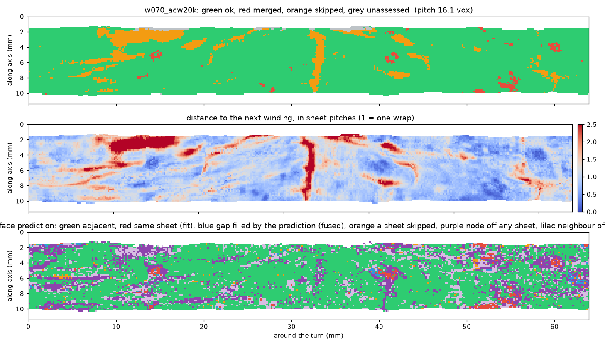

# winding-audit

Checks the windings of a spiral fit against each other and against the surface prediction, and says where two
windings sit on the same sheet, where a wrap was skipped, and where a node is not on a sheet at all.

**Status: 0.1, audit only (12 October 2026).** Repair (re-snapping a flagged region to the right sheet, cutting what
cannot be repaired) is the next step. Numbers in this README are measurements on real fits and will change.

## Why

Erwin Nieuwlaar's PHerc. 343 First Letters recipe (villa `fit_spiral` → snap onto the surface prediction → lasagna
flatten → render → ink) is now run by several groups. Its windings are accepted by eye. Nothing checks that winding
k and winding k+1 lie on different sheets everywhere, or that a winding does not drift onto its neighbour's sheet. A
winding on the wrong sheet renders the back of the next wrap, and the ink models then read nothing.

On our own PHerc. 0175A fit (120 snapped windings, band z 6900–7900), 1–6 % of the nodes of every winding pair are
within 4 voxels of the next winding (two windings on one sheet) or more than 2.2× the median spacing from it (a wrap
skipped), worst on the inner windings. This tool makes that visible per node, per winding and per band.

## What it measures

1. **Neighbour spacing.** Distance from every node of winding k to the nearest node of winding k+1 (KD-tree). The
   sheet pitch is the pair's median spacing. `merged` = closer than 0.3 × pitch; `skipped` = farther than 1.7 × pitch.
   Nodes whose nearest neighbour point is on the neighbour's own boundary are `unassessed` (the true nearest point
   is outside the neighbour's coverage).
2. **Sheets between.** Along the straight segment from the node to its nearest point on winding k+1, the surface
   prediction (m7, uint8; binary in the published level-0 stores) is sampled every voxel and thresholded at 128.
   First each end is checked: a node that is not on any predicted sheet (`node_off_sheet`) is a finding on its own,
   because a render at that node samples nothing but the gap. When both ends are on a sheet, the number of sheet runs between them gives the verdict: 2 = adjacent
   wraps, 3+ = a wrap was skipped, 1 = one unbroken run joins them, which is `merged` (both windings on one
   sheet, a fit error) when the neighbour is closer than half a pitch and `fused` (the prediction fills the gap
   between two wraps, a model error in a compressed region) when it is about a pitch away. This separates fit
   errors from prediction errors, which the spacing check alone cannot do.
3. **Report.** `audit.csv` / `audit.json` with one row per winding pair (pitch, spacing fractions merged / skipped /
   unassessed, fraction of nodes off any sheet, and among nodes with both ends on a sheet the fractions adjacent /
   merged / skipped, plus area in cm² when `--voxel-um` is given), `summary.json` for the band, per-pair maps
   (`maps/<winding>.npz`: distance, flag, verdict, runs on the winding grid), `--grid-figures` (one PNG per winding
   with the three maps) and `--sections` cross-section PNGs at the requested z (all windings over the prediction
   slice, coloured green ok / red merged / orange skipped / grey unassessed). The audit is resumable: pairs already
   written are skipped on a re-run.

## First results (12 October 2026)

Three bands fitted with the PHerc. 343 recipe (villa `fit_spiral` at `0fb38c45`, 20k steps, snapped onto the
published m7 prediction at level 0), 120 windings each, audited against the same prediction. Fractions are of the
nodes with both ends on a predicted sheet, except "on no sheet", which is of all assessed nodes.

| band | voxel | area | on no sheet | adjacent | same sheet (fit) | gap filled by prediction | wrap skipped | time |
|---|---|---|---|---|---|---|---|---|
| PHerc. 0175A, z 6900–7900 | 8.64 µm | 645 cm² | 22 % | 77 % | 9 % | 11 % | 3 % | 22 min |
| PHerc. 0813, z 12200–13200 | 9.36 µm | 702 cm² | 42 % | 69 % | 11 % | 10 % | 9 % | 19 min |
| PHerc. 0800, z 5300–6300 | 8.64 µm | 661 cm² | 35 % | 62 % | 15 % | 18 % | 5 % | 19 min |

On PHerc. 0175A the outer windings (w050–w129, pitch ~16 voxels) are 88–95 % adjacent with 2–6 % same-sheet nodes;
the inner core (w010–w040, pitch 7–11 voxels) is only 13–35 % adjacent, with the rest split between windings on one
sheet and a prediction that no longer separates the wraps. The 22–42 % of nodes on no predicted sheet are where a
render samples the gap rather than papyrus.




## Use

```
pip install -e .            # numpy, scipy, zarr>=3, tifffile, matplotlib
winding-audit audit <dir with w000_<tag>/ ... tifxyz folders> --surface <m7 prediction zarr root> --group 0 \
    --out runs/pherc0175a_band1 --voxel-um 8.64 --sections 7000 7400 7800
```

`--surface` is the surface prediction at the same resolution level as the tifxyz coordinates (level 0 voxels for the
spiral fitter's output). `--no-sheets` runs the spacing check only. The synthetic scroll used by the tests:

```
winding-audit synthetic demo --merge 1 1.0 2.0 --skip 4 3.5 4.5
winding-audit audit demo/windings --surface demo/surface.zarr --out demo/audit --sections 12
pytest tests
```

## Inputs and limits

- Input windings are tifxyz folders as written by villa's spiral fitter / snap (x.tif, y.tif, z.tif, meta.json;
  -1 = no node), one folder per winding named `w<NNN>…`. Consecutive winding numbers are assumed to be consecutive
  wraps.
- The pitch is estimated per pair from the data; a pair whose majority is wrong (every node merged) would get a wrong
  pitch. The sheet count does not depend on the pitch and catches that case.
- Nodes are compared to the neighbour's nearest *node*, not its interpolated surface, so distances carry up to half a
  grid step of error (10 voxels at the default 20-voxel grid); the flags use wide margins (0.3× and 1.7× pitch).
- Agreement with the surface prediction is agreement with a model, not with the papyrus.

## Credits

Built on villa's spiral fitter and tifxyz format (ScrollPrize), the m7 surface predictions (Vesuvius Challenge open
data), and Erwin Nieuwlaar's PHerc. 343 recipe (snap step). Developed with AI assistance under my direction.

MIT license.
