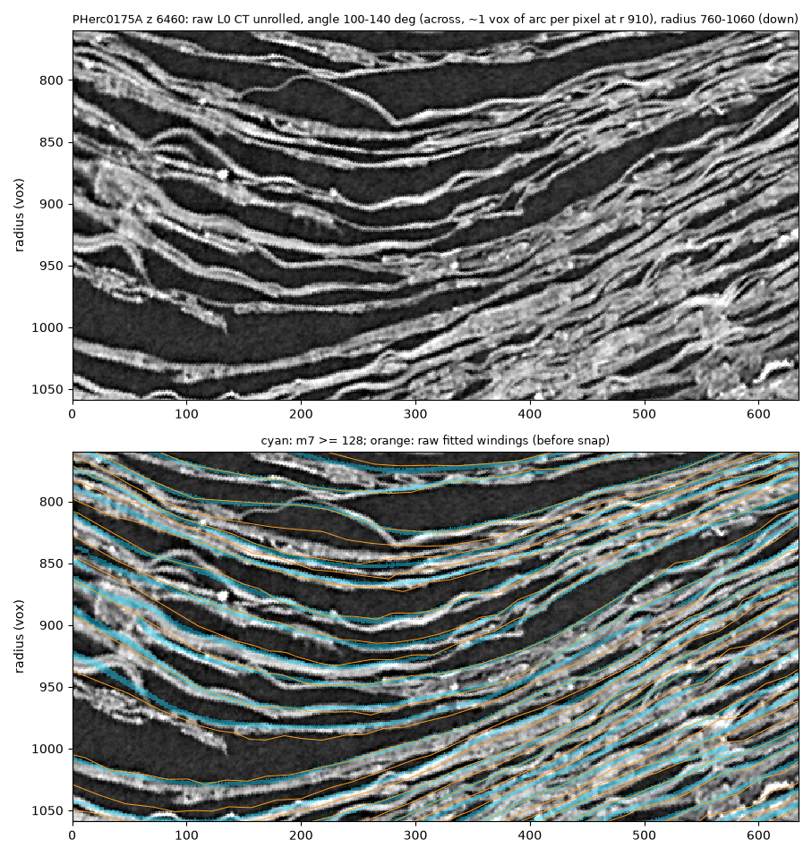
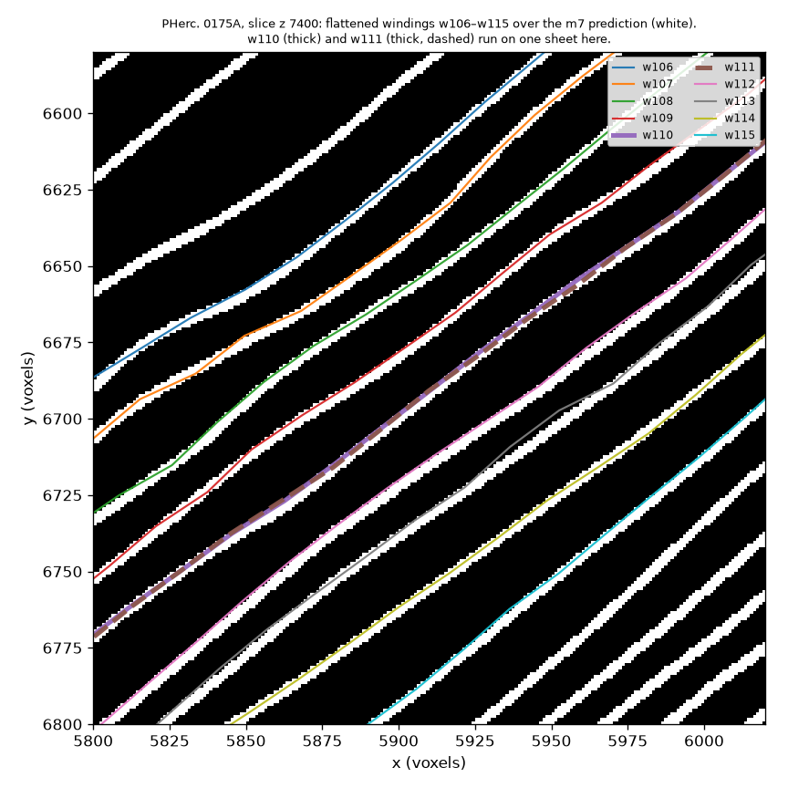
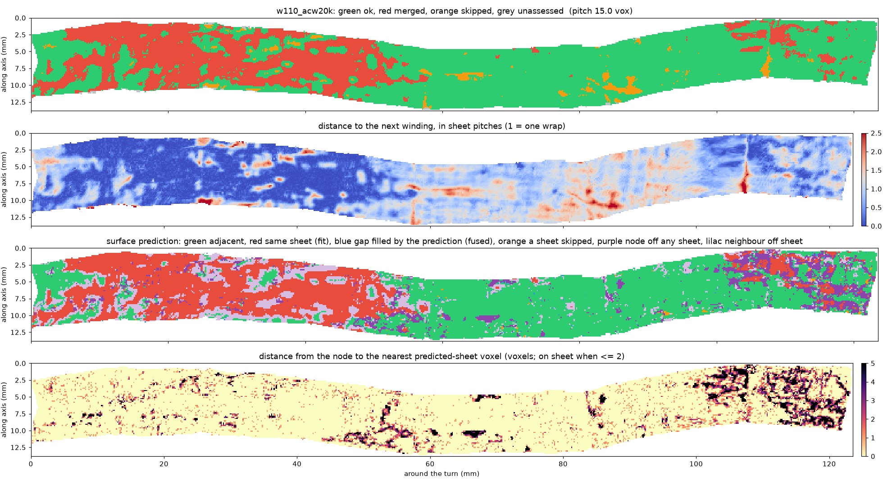
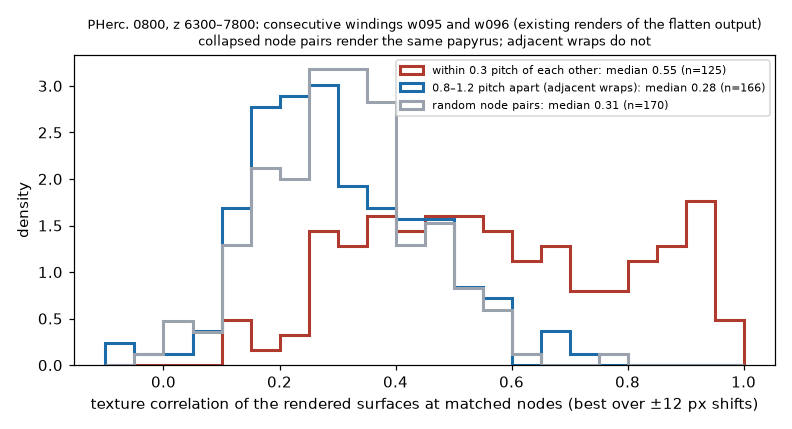
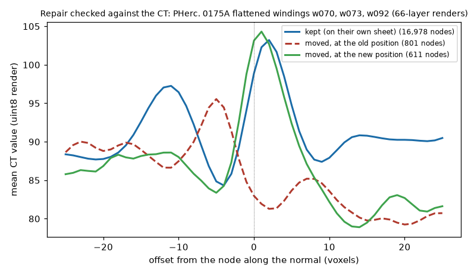
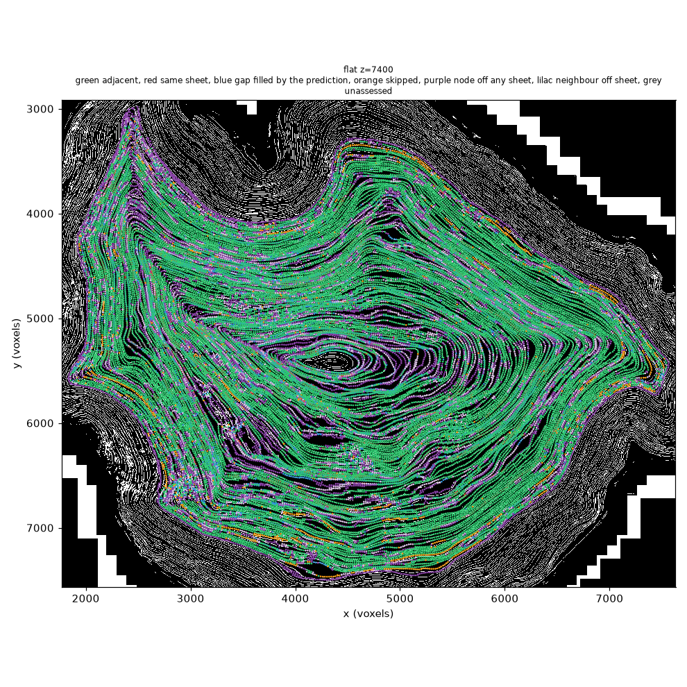
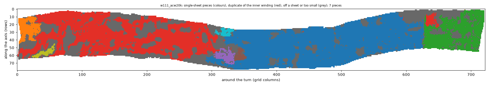
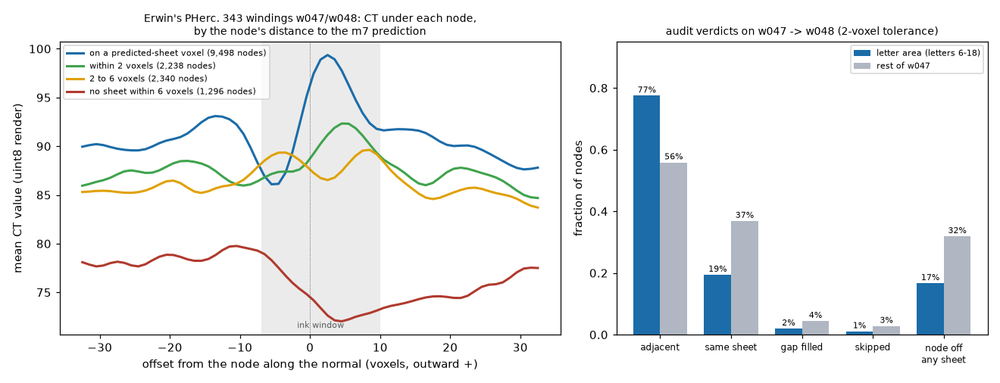

# winding-audit

Checks the windings of a spiral fit against each other and against the surface prediction, and says where two
windings sit on the same sheet, where a wrap was skipped, and where a node is not on a sheet at all.

**Status: 0.4.1 (13 October 2026): audit, repair, single-sheet pieces, and a density count.** The audit measures, per node, how far
each winding is from the next one's surface and from the predicted sheets. The repair moves a node that is off any
sheet, or on a neighbouring winding's sheet, onto the sheet between its two neighbours. The pieces mark which parts
of each winding stay on one sheet and are read only once. Numbers in this README are measurements on real fits and
will change.

**Paper:** [paper/paper.pdf](paper/paper.pdf) ("One Winding per Sheet"), built from `paper/paper.html` with
`python paper/build.py`. **In villa:** `spiral-fitting/check_fit_against_prediction.py` (branch
`tauil/spiral-sheet-reindex` of the author's fork) checks a fit checkpoint against the prediction in the fit's own
spiral space.

## Why

Erwin Nieuwlaar's PHerc. 343 First Letters recipe (villa `fit_spiral` → snap onto the surface prediction → lasagna
flatten → render → ink) is now run by several groups. Its windings are accepted by eye. Nothing checks that winding
k and winding k+1 lie on different sheets everywhere, or that a winding does not drift onto its neighbour's sheet. A
winding on the wrong sheet renders the same papyrus as its neighbour, or the gap between wraps, and the ink models
then read nothing new.

On our own PHerc. 0175A fit (120 windings, band z 6900–7900, 853 cm² after flattening), 21 % of the nodes lie within
0.3 sheet pitch of the next winding's surface: 45 of 119 winding pairs share a sheet on a quarter or more of their
nodes, 21 on half or more and 6 on 70 % or more. 15 % of the nodes are on no predicted sheet. Erwin's winning pair shows the same defects, at similar
rates, mostly outside its letters. This tool makes them visible per node, per winding and per band, repairs the part
that a re-snap can repair, and marks the single-sheet pieces of the rest, each kept once.

## What it measures

1. **Neighbour spacing.** Distance from every node of winding k to the *surface* of winding k+1: the nearest node
   of k+1 at a similar angle around the turn is found first (a KD-tree with the angular position as a fourth axis,
   so the spiral seam, where the end of one winding meets the start of the next, is not read as a merger), then the
   node is projected onto the tangent plane of k+1 at that node. Measuring to the nearest *node* instead misses
   windings that lie on top of each other: on a 20-voxel grid the nearest node can be 10 or more voxels to the
   side. The sheet pitch is read from the prediction itself, as the median spacing of consecutive predicted sheets
   along the node normals, so a pair that shares a sheet cannot shrink its own pitch. `merged` = closer
   than 0.3 × pitch; `skipped` = farther than 1.7 × pitch. A far node whose nearest point is on the neighbour's own
   boundary is `unassessed` (the true nearest point may be outside the neighbour's coverage).
2. **Sheets between.** First each end is placed: the exact distance from the node, and from its nearest point on
   winding k+1, to the nearest voxel of the surface prediction (m7, uint8; binary in the published level-0 stores,
   thresholded at 128). A node more than `--node-tol` voxels (default 2) from any predicted sheet is `node_off_sheet`,
   a finding on its own: on Erwin Nieuwlaar's PHerc. 343 windings such nodes sit in a CT trough and render no papyrus
   (see the positive control below). When both ends are on a sheet, the prediction is sampled every voxel along the
   straight segment between them and the runs of sheet voxels give the verdict: 2 = adjacent
   wraps, 3+ = a wrap was skipped, 1 = one unbroken run joins them, which is `merged` (both windings on one
   sheet, a fit error) when the neighbour is closer than half a pitch and `fused` (the prediction fills the gap
   between two wraps, a model error in a compressed region) when it is about a pitch away. This separates fit
   errors from prediction errors, which the spacing check alone cannot do.
3. **Close pairs.** Each pair's median spacing is compared with the prediction's sheet pitch. A ratio below 0.75
   is a close pair (`pairs_collapsed` in `summary.json`): on a fit before the snap, the windings are denser than
   the sheets; after the snap, the pair shares a sheet over part of the turn (how much is the fraction of nodes
   within 0.3 pitch). Without a prediction, the ratio is taken against the mean pair spacing of three pairs either
   side, and a pair above 1.25 is `stretched`.
4. **Report.** `audit.csv` / `audit.json` with one row per winding pair (pitch, local pitch and their ratio, spacing fractions merged / skipped /
   unassessed, fraction of nodes off any sheet and within 1 / 2 / 3 voxels of one, and among nodes with both ends on
   a sheet the fractions adjacent / merged / fused / skipped, plus area in cm² when `--voxel-um` is given),
   `summary.json` for the band, per-pair maps (`maps/<winding>.npz`: distance, flag, verdict, runs, node-to-sheet
   distance on the winding grid), `--grid-figures` (one PNG per winding with the four maps) and `--sections`
   cross-section PNGs at the requested z (all windings over the prediction slice, coloured by spacing flag and by
   sheet verdict). The audit is resumable: pairs already written are skipped on a re-run.

5. **Repair** (`winding-audit repair`). The PHerc. 343 snap moves each node along its normal to the *nearest*
   predicted sheet within ±15 voxels; with a pitch of 10–20 voxels that can be the next wrap's sheet. The repair
   uses the neighbours as bounds. Along the node's normal, oriented from winding k−1 to winding k+1, the prediction
   is sampled over ±2.5 pitches and its sheet runs are listed. A node on its own run (within 2 voxels) that is not a
   neighbour's run is kept, bit for bit. A node on a run it shares with a neighbour half a pitch or more away is
   kept too (`kept_shared_run`): the prediction joins the two wraps there and cannot say which node, if any, is
   wrong. A node off any sheet, or sharing a run with a neighbour closer than half a pitch, moves to the centre of
   the nearest run strictly between the two neighbours' runs, at most 1.25 pitches away. If there is none, the node
   stays and is reported `unrepaired`: either the neighbour is the misplaced one (it is moved when its own turn
   comes), or there is no free sheet between the neighbours. A move larger
   than 0.4 pitch must agree with at least two neighbouring moves, or it is undone, so the repair cannot pull a
   spike out of the mesh. Windings are repaired from the inside out, each against its already-repaired inner
   neighbour, so two windings on one sheet are separated once. Skipped wraps are left alone: every winding after
   the skip follows it, so no node is misplaced locally; it is a topology error and stays in the audit.

6. **Pieces** (`winding-audit pieces`). What a re-snap cannot fix can still be marked. For each winding, the nodes
   on a predicted sheet are joined across grid edges that stay on one sheet (the step along the normal is under
   0.35 pitch and the points at 1/4, 1/2 and 3/4 of the edge are on a sheet). Pieces are cut at the edge of a
   shared-sheet region (nodes within 0.3 pitch of a neighbour), because a winding can only reach another sheet by crossing a gap or by landing on a
   neighbour's sheet. Going from the inside out, nodes that lie on the inner neighbour's kept surface are dropped
   as duplicates, so a shared sheet is kept once, in the inner winding. Pieces under 0.05 cm² are dropped. The
   output is a mask per winding (a masked tifxyz and a piece-label image), so an existing render can be read
   through it unchanged.

## Results (12 October 2026, v0.3)

Three bands fitted with the PHerc. 343 recipe (villa `fit_spiral` at `0fb38c45`, 20k steps, snapped onto the
published m7 prediction at level 0, then lasagna-flattened), 120 windings each, audited against the same
prediction after the snap and after the flatten (the flatten output is what gets rendered). Erwin Nieuwlaar's
released pair is the control. "Off any sheet" and "within 0.3 pitch" are fractions of all assessed nodes; the four
sheet verdicts are fractions of the nodes with both ends on a predicted sheet. A close pair has a median
spacing under 0.75 of the prediction's sheet pitch; on the raw fit, before the snap, that means the two windings
are too close, not yet on one sheet (the snap then puts them on one over part of the turn). Nodes of the raw fit are not on sheets yet,
so its "off any sheet" figure is expected to be high.

<!-- results-table -->
| band | stage | area | off any sheet | within 0.3 pitch of the next winding | adjacent | same sheet | gap filled | wrap skipped | close pairs (< 0.75 pitch) |
|---|---|---|---|---|---|---|---|---|---|
| PHerc. 343, w047→w048 (Erwin Nieuwlaar, control) | flatten | 7 cm² | 28 % | 22 % | 61 % | 32 % | 4 % | 2 % | 0 of 1 |
| PHerc. 0175A, z 6900–7900 | fit (before snap) | 645 cm² | 46 % | 3 % | 87 % | 6 % | 4 % | 3 % | 50 of 119 (198 cm²) |
| PHerc. 0175A, z 6900–7900 | snap | 645 cm² | 14 % | 21 % | 71 % | 26 % | 1 % | 2 % | 42 of 119 (179 cm²) |
| PHerc. 0175A, z 6900–7900 | flatten | 853 cm² | 15 % | 21 % | 71 % | 25 % | 1 % | 2 % | 41 of 119 (232 cm²) |
| PHerc. 0175A, z 6900–7900 | flatten + repair | 853 cm² | 13 % | 20 % | 73 % | 24 % | 1 % | 2 % | 40 of 119 (218 cm²) |
| PHerc. 0813, z 12200–13200 | snap | 702 cm² | 32 % | 17 % | 60 % | 27 % | 6 % | 7 % | 27 of 119 (178 cm²) |
| PHerc. 0813, z 12200–13200 | flatten | 1090 cm² | 34 % | 17 % | 60 % | 27 % | 6 % | 7 % | 29 of 119 (298 cm²) |
| PHerc. 0800, z 5300–6300 | snap | 661 cm² | 25 % | 25 % | 53 % | 37 % | 7 % | 3 % | 77 of 119 (373 cm²) |
| PHerc. 0800, z 5300–6300 | flatten | 1037 cm² | 28 % | 24 % | 52 % | 37 % | 8 % | 3 % | 87 of 119 (722 cm²) |
<!-- /results-table -->

- **The main defect is consecutive windings that share a sheet over part of the turn.** On PHerc. 0175A, 21 % of
  the flattened nodes are within 0.3 pitch of the next winding's surface. The overlap is partial: 44 of 119 pairs
  share a sheet on a quarter or more of their nodes, 21 on half or more, 6 on 70 % or more. Exact point-to-triangle distances to the neighbouring mesh confirm it (w030→w031: 55 % of
  nodes within 2 voxels; w070→w071: 2 %). Where two windings share a sheet, every sheet around them still holds a
  winding, so the band has more windings than sheets there (next points). Erwin's winning pair has the same defect over 21.5 % of w047, mostly outside the
  letters (14 % inside the letter area, 24 % elsewhere).
- **Windings that share a sheet render the same papyrus.** On two consecutive PHerc. 0800 windings (w095 and w096 of a band
  at z 6300–7800, rendered from the flatten output), the rendered surface patches at matched nodes correlate at a
  median of 0.55 where the audit puts the windings within 0.3 pitch, against 0.28 for adjacent wraps and 0.31 for
  random pairs. The audit's "same sheet" is the CT's "same papyrus, read twice".
- **Against the raw CT the excess is smaller: much of it is sheets the prediction misses (correction, 13 October).**
  Along node normals on three rendered PHerc. 0175A windings, the CT's dominant period (first autocorrelation
  peak of the depth profiles) is 15–17 voxels, close to the prediction's pitch (14–15). But counting bright CT
  layers along radial rays in the raw L0 CT (intensity peaks at prominence 0.5 / 1 / 1.5 local standard deviations,
  brighter than the air between layers; `tools/ct_layers_along_rays.py`) gives fewer windings per layer than per
  predicted sheet. The same counter on the awarded PHerc. 343 pair calibrates it, and the share of consecutive
  snapped windings within 2 voxels of each other along the rays (`tools/ct_pair_gaps.py`) does not depend on it:

  | fit, slice | windings per predicted sheet | windings per CT layer | predicted / CT layers (middle) | consecutive windings < 2 vox apart |
  |---|---|---|---|---|
  | PHerc. 0800 z 5300–6300, z 5820 (62 rays where the CT was cached) | 1.61 | 1.00 / 1.20 / 1.49 | 0.81 | 17 % |
  | PHerc. 0175A z 5900–6900 refit, z 6460 (36 rays, w040–w115) | 1.47 | 1.13 / 1.36 / 1.55 | 0.91 | 15 % |
  | PHerc. 0175A z 6900–7900 fit, z 6990 (180 rays) | | | | 15 % |
  | awarded PHerc. 343 pair w047/w048, 4 slices (303 gaps) | | 0.82 CT layers per turn step | | 1.7 % |

  On the awarded pair the counter finds 0.8 CT layers per turn step (a peak count does not by itself establish
  windings: villa `SCROLL_ANATOMY.md`); scaled by that, our fits are at about 1.0–1.1 windings per layer against
  1.5–1.6 per predicted sheet, so much of the excess over the prediction is sheets it misses (it has 81–91 % of the
  CT's layers). What holds however layers are counted: after the snap, 15–17 % of consecutive windings sit within
  2 voxels of each other, ten times the awarded pair's rate, and render the same papyrus; and a larger pitch is not
  the general fix. The unrolled strip below shows windings running through empty gaps and bright layers with no
  prediction on them. The share of CT layers with no winding nearby is not a usable measure on its own: between the
  awarded pair's windings, which are about 23 voxels apart, a third of the gaps hold a CT peak more than 8 voxels from
  both.

- **Counted along radial rays, the fits have 1.2–1.6 windings per predicted sheet.** `winding-audit density` casts rays from
  the centre of a slice and counts, between the crossings of w040 and w115, the windings and the predicted sheets
  they pass. Before any snap:

  | fit (w040 to w115) | slices | windings per predicted sheet | radius per winding |
  |---|---|---|---|
  | PHerc. 0800, z 6300–7800 | 6600, 7500 | 1.54, 1.52 | 17.5, 19.0 vox |
  | PHerc. 0800, z 5300–6300 | 5500, 6100 | 1.60, 1.47 | 17.0, 17.1 vox |
  | PHerc. 0175A, z 6900–7900 | 7100, 7700 | 1.39, 1.39 | 18.3, 18.6 vox |
  | PHerc. 0813, z 12200–13200 | 12400, 13000 | 1.23, 1.20 | 18.0, 18.1 vox |

  Every fit advances 17–19 voxels of radius per winding whatever the scroll, while the predicted sheets are 22–29
  voxels apart along the same rays. `fit_spiral` learns its spiral pitch (`dr_per_winding`) from a starting value,
  `model_initial_dr_per_winding` = 16 by default; in the PHerc. 0800 z 6300–7800 checkpoint it ended at 16.8. The
  pitch stays where it starts, so the starting value matters. It should be the scroll's own sheet spacing measured
  in the raw CT, not in the prediction (previous point): on PHerc. 0800 the prediction's spacing overstates it.
- **The shared sheets start in the fit, and the snap makes them.** Before the snap, the PHerc. 0175A windings do not touch
  (2.4 % of nodes within 0.3 pitch of the next winding), but the inner ones are 8–10 voxels apart against a sheet
  pitch of 15 in the prediction: about 1.5 windings per sheet. The snap then moves every winding to its nearest
  sheet, and pairs of windings land on the same one (21 %), next to gaps of about 17 voxels. Comparing the fit's
  winding spacing with the prediction's sheet spacing before snapping shows where the fitted spiral has too many
  turns.
- **The other two bands.** PHerc. 0813: 17 % of nodes within 0.3 pitch of the next winding, 29 close pairs, and
  34 % of nodes off any sheet. PHerc. 0800: 24 % within 0.3 pitch, 87 of 119 close pairs, 55 pairs sharing a sheet
  on a quarter or more of their nodes (2 on half or more), and only 52 % adjacent wraps. Its fit is
  too dense across the whole band, not only in the core: at four sampled windings (w020, w050, w080, w110), before
  the snap the windings are 9.5–12 voxels apart against a predicted sheet pitch of 16.5–17.5. A winding that runs between two sheets is snapped to one or the
  other depending on its local offset, so it can switch sheets around the turn.
- **15 % of the flattened PHerc. 0175A nodes are on no predicted sheet.** On the control, such nodes sit in a CT trough: a render
  there samples the gap between wraps.
- **The repair moves 3.1 % of the nodes onto a sheet between their neighbours, and the CT confirms the moves.** On
  three PHerc. 0175A windings that have 66-layer renders, the 811 moved nodes inside the renders go from a mean CT
  value of 83 at their old position to 104 at the new one (nodes kept on their own sheet: 99). Over the band, nodes
  off any sheet drop from 15.2 % to 12.7 % and adjacent wraps rise from 71.4 % to 73.2 %. Windings that share a
  sheet stay: with both neighbours on the sheets around it, a winding has no free sheet to move to. They need a re-fit, not a
  re-snap.













## Single-sheet pieces (13 October 2026, v0.4)

How much of each band is surface that stays on one sheet and is read once. Areas here count all 120 windings of a
band (the audit table counts the 119 that have a next winding).

<!-- pieces-table -->
| band | area | on a sheet | duplicate of the inner winding | kept in single-sheet pieces | pieces (≥ 1 cm²) |
|---|---|---|---|---|---|
| PHerc. 343, w047 + w048 (control) | 14 cm² | 74 % | 1 cm² (6 %) | **7 cm² (48 %)** | 17 (2) |
| PHerc. 0175A, flatten | 867 cm² | 85 % | 118 cm² (14 %) | **513 cm² (59 %)** | 873 (104) |
| PHerc. 0175A, flatten + repair | 867 cm² | 87 % | 115 cm² (13 %) | **538 cm² (62 %)** | 840 (107) |
| PHerc. 0813, flatten | 1107 cm² | 65 % | 57 cm² (5 %) | **383 cm² (35 %)** | 1345 (89) |
| PHerc. 0800, flatten | 1054 cm² | 72 % | 103 cm² (10 %) | **339 cm² (32 %)** | 1577 (42) |
<!-- /pieces-table -->

- **About a third to three fifths of each band is single-sheet surface read once.** PHerc. 0175A keeps 513 of
  867 cm² (59 %), PHerc. 0813 383 of 1,107 cm² (35 %), PHerc. 0800 339 of 1,054 cm² (32 %). The repair adds 25 cm²
  on PHerc. 0175A (538 cm²).
- **What is kept is papyrus; what is dropped is gap or a second copy.** On the three rendered PHerc. 0175A windings,
  kept nodes have a mean CT value of 99 at the node; dropped off-sheet nodes 90 (the gap between wraps); dropped
  duplicates 114 (papyrus that the inner winding already covers).
- **Erwin's letters survive the mask.** 15 of the 18 letter centres of the PHerc. 343 image lie in a kept piece (one
  of them through w047's copy: at letters 4 and 5, w048 lies 0.3–1.8 voxels from w047's surface, so the same
  papyrus is kept once, in w047). For the other three, 40–64 % of the surrounding 5 × 5 nodes are kept.
- **The mask is conservative.** Pieces break wherever the prediction has a hole along the sheet, so some real
  papyrus is dropped as "cut or too small" (mean CT 102). It is meant to say which parts of a render can be trusted,
  not to replace the render.



## Positive control: Erwin Nieuwlaar's PHerc. 343 windings

The two windings of the awarded PHerc. 343 First Letters image (w047 and w048, z 9500–11000, released by Erwin
Nieuwlaar as lasagna flatten output on a 20-voxel grid) were audited against the m7 prediction he snapped to
(`20250521140437-surface-20260413222639-surface-m7-L0-th0.2.zarr`, level 0). The CT under each node was read from a
66-layer render of his concatenated mesh.



- **The off-sheet measure tracks the CT.** Nodes on a predicted-sheet voxel have a sharp papyrus peak 2.5 voxels
  outward, inside the ink window. Nodes 2–6 voxels from the prediction have a weak peak at the window's edge. Nodes
  with no predicted sheet within 6 voxels sit in a CT trough about 20 grey levels darker: a render there samples the
  gap between wraps.
- **The area where the text was read scores higher.** Inside the letter area of w047 (letters 6–18), 77 % of the
  nodes with both ends on a sheet are adjacent wraps, 19 % share a sheet with w048, and 17 % of nodes are off any
  sheet. On the rest of w047 the figures are 56 %, 37 % and 32 %. 16 of the 18 letter centres lie on a
  predicted-sheet voxel.
- **A winning pair is not clean everywhere.** 21.5 % of w047's nodes are within 0.3 pitch (4.7 voxels) of w048's
  surface: 14 % in the letter area, 24 % elsewhere. Exact point-to-triangle distances to the w048 mesh give the same
  figure (20.6 %). Over the whole pair, 28 % of nodes are off any sheet; of the rest, 61 % are adjacent wraps, 32 %
  share a sheet with w048, 4 % have the prediction filling the gap and 2 % skip a wrap. The audit is a map of where
  a winding can be trusted, not a pass or fail for the whole winding.

## Use

```
pip install -e .            # numpy, scipy, zarr>=3, tifffile, matplotlib
winding-audit audit <dir with w000_<tag>/ ... tifxyz folders> --surface <m7 prediction zarr root> --group 0 \
    --out runs/pherc0175a_band1 --voxel-um 8.64 --sections 7000 7400 7800
```

```
winding-audit repair <band dir> --surface <m7 zarr root> --group 0 --out runs/pherc0175a_band1_repaired \
    --audit --voxel-um 8.64
# repaired tifxyz in <out>/windings, per-node shift/status maps, repair.csv, and the audit of the result in <out>/audit
```

```
winding-audit density <fit dir: meshes/fitted_<tag>> --surface <m7 zarr root> --group 0 --z 6600 7500 \
    --first w040 --last w115
# windings per predicted sheet along radial rays; 1.0 = one winding per sheet
```

Run the audit on the fit output too, before the snap (`meshes/fitted_<tag>` of a `fit_spiral` run): there the
nodes are not on sheets yet, but the pitch ratio already shows where the fit has too many turns. Pairs under 0.75
of the prediction's sheet pitch will be paired up by a nearest-sheet snap.

```
winding-audit pieces <band dir> --surface <m7 zarr root> --group 0 --out runs/pherc0175a_pieces --voxel-um 8.64 \
    --figures
# masked tifxyz in <out>/windings, piece labels in <out>/labels, pieces.csv and pieces_summary.json
```

`--surface` is the surface prediction at the same resolution level as the tifxyz coordinates (level 0 voxels for the
spiral fitter's output). `--no-sheets` runs the spacing check only. `--subdir tifxyz/flatten.tifxyz` reads lasagna
flatten output, where each winding folder holds its tifxyz one level down. `--node-tol` sets how far (voxels) a
node may be from a predicted sheet and still count as on it; the per-node distance is in the maps either way.
The synthetic scroll used by the tests:

```
winding-audit synthetic demo --merge 1 1.0 2.0 --skip 4 3.5 4.5
winding-audit audit demo/windings --surface demo/surface.zarr --out demo/audit --sections 12
pytest tests
```

## Inputs and limits

- Input windings are tifxyz folders as written by villa's spiral fitter / snap (x.tif, y.tif, z.tif, meta.json;
  -1 = no node), one folder per winding named `w<NNN>…`. Consecutive winding numbers are assumed to be consecutive
  wraps.
- The pitch comes from the prediction's sheet spacing (median over 2,000 sampled nodes per winding). Missed sheets
  in the prediction make it slightly long (on PHerc. 0175A, 14–17 voxels against 12–13 for clean winding pairs).
  Without a prediction (`--no-sheets`) the pair's own median spacing is used and close pairs are judged against
  the mean of the neighbouring pairs.
- The neighbour's surface is its tangent plane at the nearest node, not the exact mesh. Checked against exact
  point-to-triangle distances on PHerc. 0175A: within 1 voxel for about 90 % of nodes.
- Windings that share a sheet are reported, not repaired: separating them means moving every later winding by one sheet in
  that sector, which is a re-fit.
- Agreement with the surface prediction is agreement with a model, not with the papyrus. The CT checks in this
  README cover the control pair, three rendered PHerc. 0175A windings and two rendered PHerc. 0800 windings.

## Credits

Built on villa's spiral fitter and tifxyz format (ScrollPrize), the m7 surface predictions (Vesuvius Challenge open
data), and Erwin Nieuwlaar's PHerc. 343 recipe (snap step). Developed with AI assistance under my direction.

MIT license.
